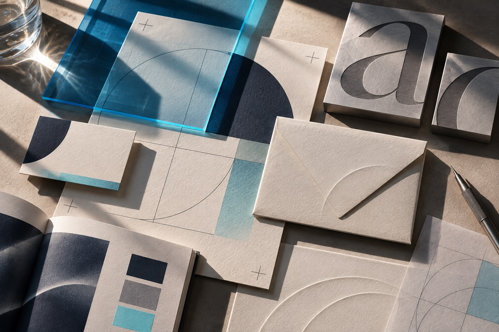

  <picture>
    <source media="(prefers-color-scheme: light)" srcset="./public/brand/aurakode-lockup-ink.svg">
    
  </picture>

  <h3>Brand Identity · Digital Experiences · Business Systems · Growth</h3>

  

    <strong>Build the business they remember.</strong> 
    We connect what your business says, what customers experience, and how your team delivers.
  

  

    
    
    
  

---

  

## One Studio. One Connected Promise.

AuraKode Business Solutions is a brand, digital, and growth studio based in **Siliguri, West Bengal**. We help ambitious businesses turn an idea into an identity, an experience, and a system that works in the real world.

Our approach connects the full customer journey:

> **What people see** → **How they understand it** → **What they do next** → **How the business follows through**

The result is not a collection of unrelated assets. It is a clearer brand, a more useful website, and a stronger route from attention to enquiry.

---

## What We Build

<table>
  <tr>
    <td width="50%" valign="top">
      
      <h3>Brand & Identity</h3>
      
Make the business easier to understand and impossible to confuse.

      <ul>
        <li>Positioning and key messaging</li>
        <li>Logo and visual identity systems</li>
        <li>Brand guidelines and templates</li>
        <li>Campaign art direction</li>
        <li>Brand applications</li>
      </ul>
    </td>
    <td width="50%" valign="top">
      
      <h3>Web & Business Systems</h3>
      
Make every interaction useful, visible, and easier to complete.

      <ul>
        <li>Marketing websites and landing pages</li>
        <li>Web applications and dashboards</li>
        <li>Custom business tools</li>
        <li>Forms and enquiry workflows</li>
        <li>Automations and integrations</li>
      </ul>
    </td>
  </tr>
  <tr>
    <td width="50%" valign="top">
      
      <h3>Visibility & Growth</h3>
      
Turn attention into a relevant, measurable next step.

      <ul>
        <li>Search engine optimisation</li>
        <li>Google Ads and paid campaigns</li>
        <li>Social media campaigns</li>
        <li>Landing page strategy</li>
        <li>Campaign measurement</li>
      </ul>
    </td>
    <td width="50%" valign="top">
      
      <h3>Connected Brand Experiences</h3>
      
Carry one clear promise across every customer touchpoint.

      <ul>
        <li>Content and campaign direction</li>
        <li>Website and social alignment</li>
        <li>Brand-to-customer journeys</li>
        <li>Launch programmes</li>
        <li>Ongoing improvement</li>
      </ul>
    </td>
  </tr>
</table>

---

## One Promise, Across Every Touchpoint

<table>
  <tr>
    <td align="center" width="33%">
      
      <h3>Identity</h3>
      
<strong>Give the idea a voice.</strong> Positioning, visual identity, and the rules that keep a business recognisable.

    </td>
    <td align="center" width="33%">
      
      <h3>Experience</h3>
      
<strong>Make the next step effortless.</strong> Websites and tools that answer real questions and guide useful action.

    </td>
    <td align="center" width="33%">
      
      <h3>Momentum</h3>
      
<strong>Carry the story into the world.</strong> Focused campaigns that connect discovery to a relevant destination.

    </td>
  </tr>
</table>

---

## How a Project Moves

<table>
  <tr>
    <th>01 / Understand</th>
    <th>02 / Clarify</th>
    <th>03 / Create</th>
    <th>04 / Refine</th>
    <th>05 / Deliver</th>
  </tr>
  <tr>
    <td>Business, audience, existing work, and the source of friction</td>
    <td>The opportunity, message, priority, and desired outcome</td>
    <td>Scoped design and development with visible checkpoints</td>
    <td>Structured reviews that improve the work and keep decisions clear</td>
    <td>Production-ready assets, handover, and a practical next plan</td>
  </tr>
</table>

The exact shape of every engagement varies. Work can begin with a focused project or become part of a longer programme across brand, web, systems, and growth.

---

## Find the Right Starting Point

<table>
  <tr>
    <td width="33%" valign="top">
      
      <h3>Starting Something New</h3>
      
You need a name people understand, an identity they recognise, and a website ready for launch.

      
<strong>Brand direction · Website · Launch assets</strong>

    </td>
    <td width="33%" valign="top">
      
      <h3>Building a Stronger Presence</h3>
      
The business has grown, but the brand or website still tells an older story.

      
<strong>Positioning · Redesign · Conversion path</strong>

    </td>
    <td width="33%" valign="top">
      
      <h3>Growing Beyond Manual Work</h3>
      
Enquiries, updates, and reporting are spread across too many places.

      
<strong>Digital products · Systems · Growth</strong>

    </td>
  </tr>
</table>

---

## What We Think about When We Begin

### "Our brand feels inconsistent."

We compare the website, social presence, proposals, and customer language. The gap may be in the message, visual system, or how the team applies it.

### "We need a new website."

Before rebuilding, we establish what the visitor needs to understand, what must change, and where the current journey loses attention.

### "We are getting enquiries, but the process feels scattered."

We follow the enquiry from first click to team follow-through, then improve the information, handoff, and tools around it.

### "We are generating traffic, but nothing is changing."

We connect the campaign promise to the page, offer, next action, and measurement, rather than treating traffic as the outcome.

---

## The AuraKode Difference

| Find the connected solution | Make decisions visible | Build for real use | Keep the message specific |
| --- | --- | --- | --- |
| Brand, website, operations, and growth work together instead of becoming separate projects. | Work moves through clear checkpoints, with reviewable outputs and agreed next steps. | Every identity, interface, workflow, and campaign is designed around real use. | We use direct language and name the actual deliverable or decision. |

---

## Brand Principles

  

The AuraKode mark joins an angular **A** and **K** into one forward-moving symbol. It is open, recognisable at small sizes, and free of stock technology imagery.

<table>
  <tr>
    <td align="center"><strong>Night</strong> <code>#0A1724</code></td>
    <td align="center"><strong>Paper</strong> <code>#F3F3EE</code></td>
    <td align="center"><strong>Ice</strong> <code>#F0FAFB</code></td>
    <td align="center"><strong>Signal</strong> <code>#73E7F5</code></td>
    <td align="center"><strong>Deep Blue</strong> <code>#0B83AE</code></td>
  </tr>
</table>

- **Plus Jakarta Sans** for headings and the wordmark
- **Inter** for reading text
- **JetBrains Mono** for compact annotations
- Direct, practical language instead of vague transformation claims

The complete rules and assets are documented in [`brand/identity.md`](./brand/identity.md).

---

## Working With AuraKode

AuraKode works with:

- Founders launching or repositioning a business
- Teams whose brand or website no longer reflects the offer
- Organisations growing beyond manual work
- Businesses building clearer search, advertising, or social campaigns
- Local and remote clients across India

Based in **Siliguri, West Bengal**, and working with ambitious businesses everywhere.

### Start with the problem. Leave with a clearer next step.

Useful context includes the business, audience, current challenge, existing materials, and when the change matters.

---

  

  <h2>Build the business they remember.</h2>

  **Brand Identity · Digital Experiences · Business Systems · Growth**

  
<strong>AuraKode Business Solutions</strong> Siliguri, West Bengal, India

