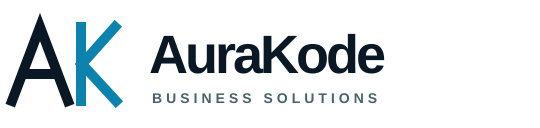
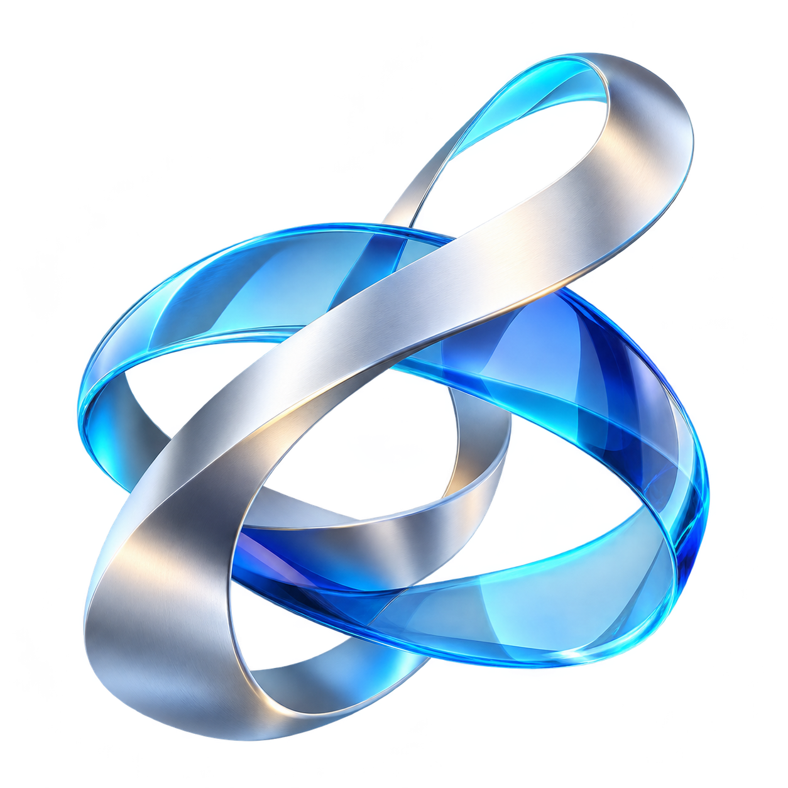
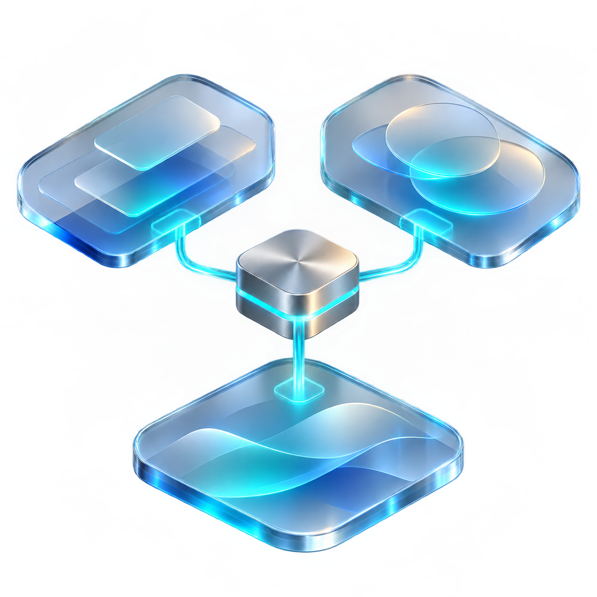
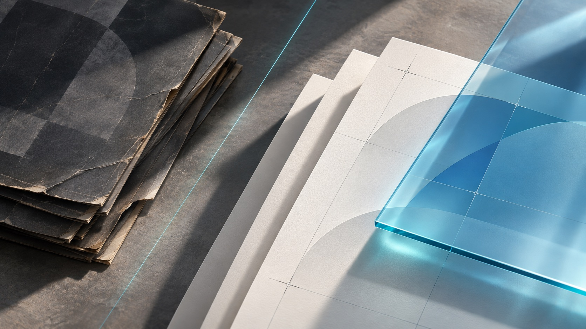
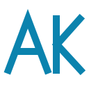

  <picture>
    <source media="(prefers-color-scheme: dark)" srcset="./public/brand/aurakode-lockup.svg">
    
  </picture>

  <h3>Brand Identity · Digital Experiences · Business Systems · Growth</h3>

  
<strong>Build the business they remember.</strong>

  
We connect what your business says, what customers experience, and how your team delivers.

  
<strong>SILIGURI, INDIA &nbsp;·&nbsp; WORKING EVERYWHERE</strong>

  

## A more connected way to grow

AuraKode Business Solutions is a brand, digital, and growth studio based in **Siliguri, West Bengal**. We help ambitious businesses turn ideas into clear identities, useful digital experiences, and systems that work in the real world.

Because a brand is more than a logo, a website is more than a page, and growth is more than traffic. The strongest business experiences connect all three.

> **What people see** → **How they understand it** → **What they do next** → **How your team follows through**

---

## What we do

  
  &nbsp;&nbsp;&nbsp;
  
  &nbsp;&nbsp;&nbsp;
  

### Brand & identity

Make the business easier to understand, recognise, and remember.

- Positioning and key messaging
- Logo and visual identity systems
- Brand guidelines, templates, and applications
- Campaign art direction

### Web & digital experiences

Give customers a clear, useful route from discovery to action.

- Marketing websites and landing pages
- Web applications and dashboards
- Responsive customer journeys
- Conversion-focused content and structure

### Business systems

Help teams reduce manual work and keep information connected.

- Custom business tools
- Enquiry and lead workflows
- Forms, dashboards, and reporting
- Integrations and automation

### Visibility & growth

Connect the right audience to a relevant next step.

- Search engine optimisation
- Google Ads and paid campaigns
- Social media campaigns
- Landing pages and measurement

---

## One promise, across every touchpoint

  
  &nbsp;
  
  &nbsp;
  

**Identity — Give the idea a voice.** Positioning, visual identity, and practical rules that help a business show up consistently.

**Experience — Make the next step effortless.** Websites and tools that answer real questions and help people take useful action.

**Momentum — Carry the story into the world.** Focused campaigns that connect discovery to a relevant destination and measurable next step.

---

## A clear process. Work you can see.

**01 — Understand**

Get to know the business, its audience, existing work, and the friction behind the brief.

**02 — Clarify**

Agree on the opportunity, priorities, outcome, scope, and measures of success.

**03 — Create**

Build the identity, experience, system, or campaign through visible checkpoints.

**04 — Refine**

Use structured reviews to make thoughtful decisions and improve the work.

**05 — Deliver**

Hand over usable work, clear documentation, and practical next steps.

Every engagement is shaped around the actual need. Start with one focused project or connect several parts into a larger programme.

---

## Where to begin

  
  &nbsp;
  
  &nbsp;
  

### Starting something new

You need a name people understand, an identity they recognise, and a website ready for launch.

**A useful starting scope:** Brand direction · Website · Launch assets

### Building a stronger presence

The business has grown, but its brand or website still tells an older story. Find what to keep and what to change.

**A useful starting scope:** Positioning · Redesign · Conversion path

### Growing beyond manual work

Enquiries, updates, or reporting are spread across too many places. Give the team a clearer way to move work forward.

**A useful starting scope:** Digital products · Systems · Growth

---

## Thoughtful work starts with the right question

**“Our brand feels inconsistent.”**

We look across the website, social presence, proposals, and customer language to find whether the gap is in the message, visual system, or how the team applies it.

**“We need a new website.”**

First, we find out what visitors need to understand, what is getting in their way, and what the new experience should help them do.

**“Our process feels scattered.”**

We trace the handoffs and information behind the work, then find ways to make the process clearer for the team and its customers.

**“We are generating traffic, but nothing is changing.”**

We connect the campaign promise to the page, offer, next action, and measurement—because traffic alone is not the outcome.

---

## What makes the work AuraKode

- **Connected thinking** — Brand, website, operations, and growth considered as parts of one experience.
- **Visible decisions** — Clear checkpoints, reviewable work, and agreed next steps.
- **Made for real use** — Practical identities, interfaces, workflows, and campaigns.
- **Specific communication** — Direct language about what is being made and why it matters.

---

## A distinct identity

The AuraKode mark brings an angular **A** and **K** together in a forward-moving symbol. Our visual language pairs deep, confident tones with a clear signal accent and typography designed to stay readable.

- **Night** `#0A1724` · **Paper** `#F3F3EE` · **Ice** `#F0FAFB`
- **Signal** `#73E7F5` · **Deep Blue** `#0B83AE`
- **Plus Jakarta Sans** for headings · **Inter** for reading · **JetBrains Mono** for compact annotations

---

  <h2>Have a business challenge in mind?</h2>
  
You do not need a perfect brief. Tell us what you do, what feels stuck, and what you want to make possible.

  
<a href="https://wa.me/916378281761?text=Hi%20AuraKode%2C%20I%27d%20like%20to%20discuss%20a%20project."><strong>START A CONVERSATION ON WHATSAPP ↗</strong></a>

  
<strong>AuraKode Business Solutions</strong> Siliguri, West Bengal, India Brand Identity · Digital Experiences · Business Systems · Growth

  

